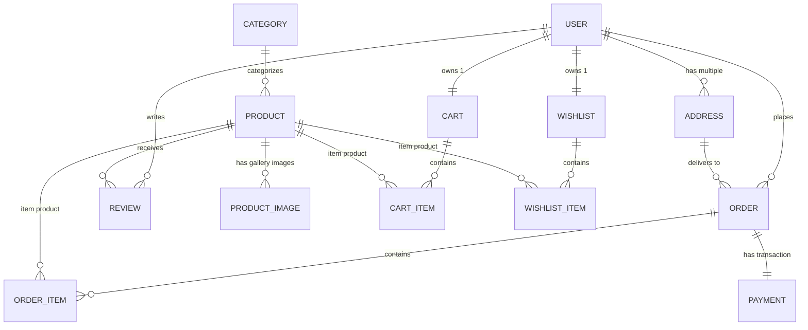

# CuddleCart — Soft Toy E-Commerce Web Application

**CuddleCart** is a complete, full-stack e-commerce web platform specifically designed for purchasing handcrafted soft toys and plush companions. Built as a full-featured MCA academic project, it incorporates a clean Model-View-Template (MVT) architecture, relational database design with MySQL configuration, role-based authentication (Customer and Admin), responsive Bootstrap 5 frontend with custom aesthetic styling, end-to-end shopping cart and wishlist systems, address management, 4-step checkout, interactive mock payment gateway simulation, order lifecycle tracking, inventory stock deduction/restoration, verified-purchase review gates, and a dedicated custom admin management console.

---

## 1. Technology Stack

- **Backend Framework:** Python 3.10+ / Django (4.2+ / 5.x / 6.x compatible)
- **Database:** MySQL (Configured via `django.db.backends.mysql` with environment variable overrides and safe SQLite fallback for portable development)
- **Frontend & UI:** HTML5, CSS3 (Vanilla custom theme), JavaScript (ES6+), Bootstrap 5.3, FontAwesome 6
- **Typography:** Playfair Display (Serif Headings) & Plus Jakarta Sans (Clean Modern Sans-Serif)
- **Image Processing:** Pillow (PIL)

---

## 2. User Roles & Access Control

| Role | Description | Access Scope |
| :--- | :--- | :--- |
| **Customer** | Registered shopper | Browse & search soft toys, apply multi-field filters, manage shopping cart & wishlist, manage delivery address book, complete 4-step checkout, simulate online / COD payments, view order history & tracking, cancel eligible orders before shipping, write verified reviews on delivered purchases, manage profile & password. |
| **Admin** | Store Administrator | Dedicated Admin Portal (`/admin-panel/`) + Standard Django Admin (`/admin/`): Monitor KPI stats (Revenue, Orders, Customers, Low Stock Alerts), Product CRUD with multi-image gallery upload, Category CRUD, Inventory stock control, Customer activation toggle, Order status pipeline (Pending $\rightarrow$ Confirmed $\rightarrow$ Processing $\rightarrow$ Shipped $\rightarrow$ Delivered $\rightarrow$ Cancelled), Payment transaction logs, Customer review moderation. |

> **Strict Project Design Restrictions:**
> - No seller / vendor registration or dashboard.
> - No coupons, discount codes, flash sales, or promotional deductions (Item subtotal = Price $\times$ Quantity; Order total = Sum of subtotals).
> - No delivery agent or third-party roles.

---

## 3. Relational Database Design (13 Entities)

The system utilizes a normalized relational database schema with foreign keys, constraints, and cascade/protection rules:



### Table Breakdown:
1. **`shop_user`**: Custom user model (`id`, `username`, `email`, `password`, `phone`, `role`, `is_active_customer`, `created_at`).
2. **`shop_address`**: Customer shipping addresses (`id`, `user_id`, `full_name`, `phone`, `house_building`, `street`, `city`, `state`, `pincode`, `country`, `address_type`, `is_default`).
3. **`shop_category`**: Product categories (`id`, `name`, `description`, `image`, `image_url`, `is_active`, `created_at`).
4. **`shop_product`**: Soft toy catalog items (`id`, `category_id`, `name`, `brand`, `size`, `age_group`, `price`, `stock_quantity`, `description`, `image`, `image_url`, `is_available`, `is_active`, `created_at`, `updated_at`).
5. **`shop_productimage`**: Additional product gallery photography (`id`, `product_id`, `image`, `image_url`, `alt_text`, `created_at`).
6. **`shop_cart`**: Customer active cart (`id`, `user_id`, `created_at`).
7. **`shop_cartitem`**: Cart line items (`id`, `cart_id`, `product_id`, `quantity`, `added_at`).
8. **`shop_wishlist`**: Customer wishlist (`id`, `user_id`).
9. **`shop_wishlistitem`**: Saved items (`id`, `wishlist_id`, `product_id`, `added_at`).
10. **`shop_order`**: Placed customer orders (`id`, `user_id`, `address_id`, `order_date`, `total_amount`, `status`).
11. **`shop_orderitem`**: Order items snapshot (`id`, `order_id`, `product_id`, `product_name`, `quantity`, `price_at_purchase`).
12. **`shop_payment`**: Payment audit log (`id`, `order_id`, `payment_method`, `amount`, `status`, `transaction_id`, `payment_date`).
13. **`shop_review`**: Customer product reviews (`id`, `product_id`, `user_id`, `rating`, `comment`, `created_at`, `updated_at`).

---

## 4. Key Functional Modules

### 4.1 Customer Experience
- **Homepage:** Hero banner (*"Bring Home a Little Happiness"*), featured categories, bestselling plushies, value trust badges, customer review highlights, responsive navbar with live cart badge.
- **Product Catalog & Filtering (`/products/`):** Search by name/brand/description, filter by Category, Brand, Size (*Small, Medium, Large, Extra Large*), Age Group (*0–3 yrs, 3–6 yrs, 6–12 yrs, 12+ yrs*), Price Range (Min/Max), and In-Stock Only. Sort by Price (Low/High), Newest, Name (A–Z). Pagination with query parameter preservation.
- **Product Details (`/products/<id>/`):** Main interactive image gallery with thumbnail preview switcher, full specifications (brand, size, age group, material, live stock indicator), quantity selector, Add to Cart / Add to Wishlist.
- **Verified Purchase Review Gate:** Only customers who have ordered and received the product in a **Delivered** order are permitted to submit or edit star ratings (1–5) and feedback.
- **Shopping Cart (`/cart/`):** Real-time subtotal calculation, quantity adjustment with stock limit protection, remove items, clear cart, and inventory check before checkout.
- **Wishlist (`/wishlist/`):** Prevent duplicate entries, direct "Move to Cart" button, view details.
- **Address Book (`/my/profile/`):** Full address CRUD (Full name, phone, flat/building, street, city, state, pincode, country, type: Home/Work/Other, default toggle).
- **4-Step Checkout (`/checkout/`):**
  1. Review cart items
  2. Select delivery address
  3. Select payment method (Online vs Cash on Delivery)
  4. Confirm and place order
- **Mock Payment Simulation Gateway (`/payment/simulate/<order_id>/`):**
  - Simulated modes: Card, UPI / QR, Net Banking.
  - Interactive "Simulate Success" (generates reference Transaction ID, updates order to confirmed, deducts stock, clears cart) and "Simulate Failure" (marks payment failed for retry testing).
- **Order Tracking & History (`/orders/`, `/orders/<id>/`):** Visual 4-step progress timeline (*Confirmed $\rightarrow$ Processing $\rightarrow$ Shipped $\rightarrow$ Delivered*), itemized receipt, delivery address, payment details.
- **Order Cancellation:** Customers can cancel orders before shipping (*Pending, Confirmed, Processing*). Cancellation automatically restores inventory stock and updates payment status to *Refunded*.

### 4.2 Admin Management Console (`/admin-panel/`)
- **Dashboard Overview:** KPI metrics (Total Revenue, Active Orders, New Customers, Low Stock Alerts), summary cards, and quick order fulfillment queue.
- **Product Management:** Product table with search/filter, Add/Edit product form, stock quantities, and dedicated multi-image gallery manager (`/admin-panel/products/<id>/images/`).
- **Category Management:** Create, edit, and delete soft toy collections with product counts.
- **Inventory Control (`/admin-panel/inventory/`):** Dedicated table showing live stock levels, In Stock / Low Stock / Out of Stock indicators, and inline one-click stock restock form.
- **Customer Management (`/admin-panel/customers/`):** Customer directory with registration dates, order counts, and one-click account activation / deactivation toggle.
- **Order Management (`/admin-panel/orders/`):** Status filtering, order details, and status transition pipeline (Pending $\rightarrow$ Confirmed $\rightarrow$ Processing $\rightarrow$ Shipped $\rightarrow$ Delivered $\rightarrow$ Cancelled). Cancelling via admin restores inventory stock.
- **Payment Audits (`/admin-panel/payments/`):** Transaction records, payment methods, transaction IDs, timestamps, and payment statuses.
- **Review Moderation (`/admin-panel/reviews/`):** View customer reviews and delete inappropriate content.

---

## 5. MySQL Database Configuration

To connect CuddleCart to a local or remote MySQL server:

### Step 1: Create MySQL Database
In your MySQL client or MySQL Workbench:
```sql
CREATE DATABASE cuddlecart_db CHARACTER SET utf8mb4 COLLATE utf8mb4_unicode_ci;
```

### Step 2: Configure Environment Variables (or settings.py)
Set the following environment variables or provide them in your shell:
```bash
# Windows PowerShell:
$env:USE_MYSQL="True"
$env:DB_NAME="cuddlecart_db"
$env:DB_USER="root"
$env:DB_PASSWORD="your_mysql_password"
$env:DB_HOST="localhost"
$env:DB_PORT="3306"

# macOS / Linux Bash:
export USE_MYSQL="True"
export DB_NAME="cuddlecart_db"
export DB_USER="root"
export DB_PASSWORD="your_mysql_password"
export DB_HOST="localhost"
export DB_PORT="3306"
```

*(Note: If `USE_MYSQL` is omitted or set to `False`, the system automatically defaults to SQLite for local development portability).*

---

## 6. Installation & Setup Guide

### 1. Clone or Open the Workspace
```bash
cd cuddlecart
```

### 2. Create and Activate a Virtual Environment
```bash
# Windows
python -m venv venv
venv\Scripts\activate

# macOS / Linux
python3 -m venv venv
source venv/bin/activate
```

### 3. Install Dependencies
```bash
pip install -r requirements.txt
```

### 4. Apply Database Migrations
```bash
python manage.py makemigrations
python manage.py migrate
```

### 5. Seed Pre-Loaded Sample Data
Populates categories (*Teddy Bears, Animals, Cartoon Characters, Dolls, Baby Soft Toys, Pillow Plushies*), 12 sample soft toy products, customer accounts, addresses, delivered orders, and verified reviews:
```bash
python manage.py seed_demo
```

### 6. Create an Admin Superuser (Optional manual step)
```bash
python manage.py createsuperuser
```

### 7. Run the Development Server
```bash
python manage.py runserver
```
Visit **`http://127.0.0.1:8000/`** in your browser.

---

## 7. Pre-Configured Demo Accounts

| Role | Username | Password | Email | Access Path |
| :--- | :--- | :--- | :--- | :--- |
| **Admin** | `admin` | `admin123` | `admin@cuddlecart.com` | `/admin-panel/` and `/admin/` |
| **Customer** | `emily` | `password123` | `emily@example.com` | `/my/dashboard/` and `/products/` |
| **Customer (Sample 2)** | `customer` | `customer123` | `customer@example.com` | `/my/dashboard/` and `/products/` |

---

## 8. Automated Testing

CuddleCart includes an automated test suite covering all modules:
- Customer Registration (uniqueness, field validations, password match)
- Customer Login (supports username or email login) & Logout
- Product Catalog, Multi-Field Search, Category/Brand/Size/Age/Price Filters, Sorting & Pagination
- Cart quantity adjustment, stock limits, removal
- Wishlist duplicate prevention and move-to-cart operations
- Address Book CRUD & default address assignment
- Multi-step Checkout, Order Creation, and Stock Deduction
- Mock Payment Gateway Simulation (Success & Failure paths)
- Order Cancellation & Inventory Stock Restoration
- Verified Purchase Review Gate enforcement
- Admin Portal access authorization & inventory updates

To run the complete test suite:
```bash
python manage.py test shop
```

---

## 9. Project Directory Structure

```text
cuddlecart_django_project/
└── cuddlecart/
    ├── manage.py
    ├── requirements.txt
    ├── README.md
    ├── cuddlecart/
    │   ├── __init__.py
    │   ├── settings.py           # MySQL & SQLite database configuration
    │   ├── urls.py               # Root URL configuration
    │   ├── wsgi.py
    │   └── asgi.py
    ├── shop/
    │   ├── models.py             # 13 relational database models
    │   ├── views.py              # Customer & Admin views and business logic
    │   ├── urls.py               # Application routing endpoints
    │   ├── forms.py              # Forms and server-side validation
    │   ├── admin.py              # Standard Django Admin configuration
    │   ├── tests.py              # Comprehensive automated test suite
    │   ├── context_processors.py # Cart and wishlist counter processors
    │   ├── templatetags/         # Custom template tags & helpers
    │   ├── management/
    │   │   └── commands/
    │   │       └── seed_demo.py  # Sample database seeder command
    │   └── migrations/           # Database migration files
    ├── templates/
    │   └── base.html             # Base layout with navbar, footer, modals
    ├── shop/templates/shop/
    │   ├── home.html             # CuddleCart homepage
    │   ├── product_list.html     # Shop catalog with filters & sorting
    │   ├── product_detail.html   # Product details, gallery & verified reviews
    │   ├── cart.html             # Shopping cart view
    │   ├── wishlist.html         # Wishlist view
    │   ├── checkout.html         # 4-Step checkout view
    │   ├── payment_simulation.html # Mock payment gateway simulation
    │   ├── order_history.html    # Customer order history
    │   ├── order_detail.html     # Order tracking & cancellation
    │   ├── user_dashboard.html   # Customer dashboard
    │   ├── profile.html          # Profile & Address management
    │   ├── address_form.html     # Address edit form
    │   ├── login.html            # Customer / Admin login
    │   ├── register.html         # Customer registration
    │   └── admin/
    │       ├── base_admin.html   # Admin portal layout shell & sidebar
    │       ├── overview.html     # KPI metrics & quick alerts
    │       ├── products.html     # Products catalog table
    │       ├── product_form.html # Add / Edit product form
    │       ├── product_images.html # Gallery image manager
    │       ├── categories.html   # Category management
    │       ├── category_form.html # Category add/edit form
    │       ├── inventory.html    # Live stock monitoring & quick restock
    │       ├── orders.html       # Order pipeline management
    │       ├── order_detail.html # Admin order status updates
    │       ├── customers.html    # Customer directory & access toggle
    │       ├── payments.html     # Payment transaction audit logs
    │       └── reviews.html      # Customer review moderation
    ├── static/
    │   └── shop/css/style.css    # Custom pastel theme and animations
    └── media/                    # Uploaded product and category photography
```
